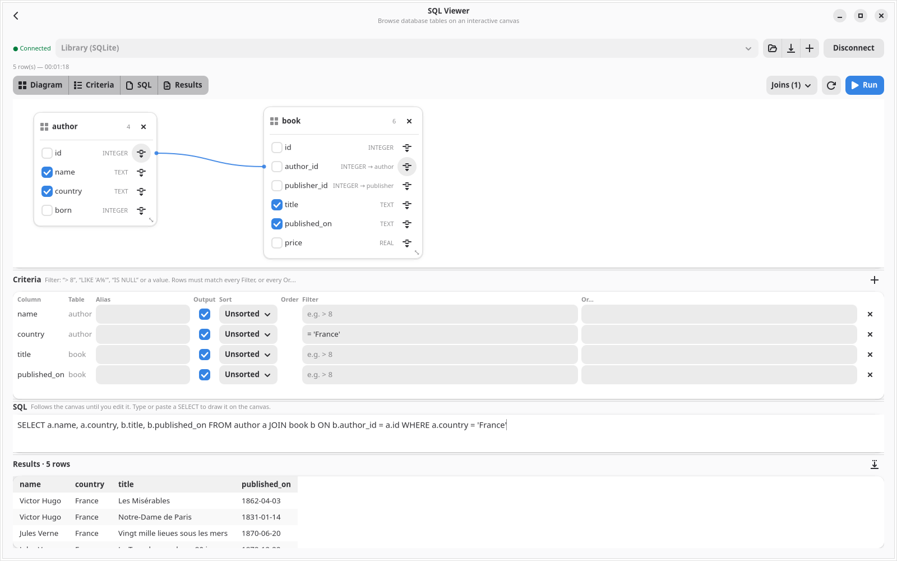

<div align="center">


# Dupot Dev Tools

**The developer's Swiss Army knife for the desktop.**

Format, convert, encode, decode, hash… and explore your SQL databases visually.
All in one native, fast, offline GTK4 / Libadwaita application written in Rust.


</div>

---

## ✨ Why Dupot Dev Tools?

How many times a day do you paste a JWT, a JSON blob or a SQL query into a random website just to read it?

Dupot Dev Tools gathers all those small everyday utilities in **one desktop app**:

- 🔒 **100% local**: your tokens, data and queries never leave your machine
- ⚡ **Native and lightweight**: a single Rust binary on GTK4, no Electron, no browser
- 🎨 **Fits your desktop**: Libadwaita UI, light and dark themes, adaptive layout, search across tools
- 🧩 **Easy to extend**: clean architecture, each tool is a small tested module

## 🧰 Tools


| Category | Tool | What it does |
|---|---|---|
| 🗄️ **Database** | **SQL Viewer** | Visual query designer for SQLite, PostgreSQL and MySQL: canvas, criteria grid, SQL and results |
| 🎨 **Formatting** | JSON Formatter | Prettify or minify JSON |
| | SQL Formatter | Format SQL queries |
| | XML Formatter | Format XML documents |
| 🔄 **Convert** | Timestamp ↔ Date | Unix timestamps (s, ms, µs, ns auto-detected) ↔ dates: UTC, local, ISO 8601, RFC 2822, relative time |
| | YAML ↔ JSON | Convert in both directions |
| | HTML to Text | Strip HTML tags to plain text |
| 🔐 **Encoding** | Base64 | Encode / decode Base64 |
| | URL Encoding | Percent-encode / decode |
| | HTML Entities | Encode / decode HTML entities |
| | JWT Decoder | Decode JWT tokens to readable JSON |
| 🔤 **String** | Hash Generator | MD5, SHA-1, SHA-2, SHA-3, BLAKE2b digests |
| | Regex Tester | Live match highlighting, capture groups (numbered and named), replace with `$1` / `${name}` |
| | Text Diff | Compare two texts: colored unified diff, stats, ignore whitespace / case |
| | UUID / ULID | Generate UUID v4 / v7, ULID, in bulk and any format; inspect version and creation date |
| 🧮 **Parsing** | Cron Parser | Explain a cron expression in plain English and list the next runs |

Every text tool shares the same layout: syntax-highlighted input and output side by side (stacked on narrow windows), one-click copy, and errors shown inline. Timestamp, UUID, Regex, Diff and Cron update live as you type.

## 🗄️ Spotlight: SQL Viewer

A visual query designer, in the spirit of SQL Server Management Studio, to understand a database at a glance:

- **Connect** to SQLite, PostgreSQL and MySQL (drivers built in, nothing else to install)
- **Save your connections** to a JSON file and reopen them (the last file reopens at startup). Passwords are never written: they are asked once per session
- **Drop tables onto a canvas** as movable, resizable cards showing every column, its type and its foreign keys
- **Joins are drawn for you** from the foreign keys; link two columns yourself or click a line to edit or remove it
- **Criteria grid**: per column, set an alias, output, sort (with sort order) and filters: `> 8`, `LIKE 'A%'`, `IS NULL` or a plain value. Rows must match every *Filter* or every *Or…*
- **The SQL follows the canvas and the grid** until you edit it by hand. Type or paste a `SELECT` and it is drawn back on the canvas and in the grid
- **Run it** (Ctrl+Enter), browse the results and **export them to CSV**
- **Four resizable panes**: *Diagram*, *Criteria*, *SQL* and *Results*, each one can be shown or hidden from the toolbar

| New connection | Add a table: joins follow the foreign keys |
|---|---|
|  |  |
| **Criteria grid: alias, filter `> 8`, sort, then Run** | **Type a `SELECT`: it is drawn on the canvas and in the grid** |
|  |  |

## 🛠️ Tech stack

| Layer | Technology |
|---|---|
| Language | Rust (2024 edition) |
| UI | GTK 4 + Libadwaita via [gtk-rs](https://gtk-rs.org), GtkSourceView 5 for code editors |
| Databases | `rusqlite` (bundled SQLite), `postgres`, `mysql` (pure-Rust, no client libraries needed), `sqlparser` (reads typed queries back onto the canvas) |
| Formats | `serde_json`, `serde_yaml_ng`, `quick-xml`, `sqlformat`, `html2text`, `csv` |
| Text & time | `regex`, `similar` (diff), `chrono`, `croner` (cron), `uuid`, `ulid` |
| Encoding / crypto | `base64`, `percent-encoding`, `html-escape`, RustCrypto (`md-5`, `sha1`, `sha2`, `sha3`, `blake2`) |
| Build & packaging | Cargo, Nix flake, Flatpak (GNOME 50 runtime), cross-compiled Windows build (MinGW-w64 + MSYS2 packages) |

## 🚀 Getting started

### Debian / Ubuntu / Linux Mint

```bash
sudo apt install cargo pkg-config libgtk-4-dev libadwaita-1-dev libgtksourceview-5-dev
git clone https://github.com/imikado/dupotDevTools.git
cd dupotDevTools
cargo run --release
```

Requires GTK ≥ 4.14 and Libadwaita ≥ 1.5 (Debian 13, Ubuntu 24.04 or newer).

### Fedora

```bash
sudo dnf install cargo gtk4-devel libadwaita-devel gtksourceview5-devel
cargo run --release
```

### Nix

```bash
nix run github:imikado/dupotDevTools   # build and launch
```

### Windows

Download the zip, extract it anywhere and run `DupotDevTools\bin\dupot-dev-tools.exe` (Windows 10 or newer).
To build it yourself, see [Packaging](#-packaging): it cross-compiles from Linux, no Windows machine needed.

## 👩‍💻 Development

```bash
nix develop        # cargo, clippy, rustfmt, rust-analyzer + GTK libraries
cargo run          # launch in debug mode
cargo test         # unit tests
cargo clippy --all-targets
```

**VSCode**: open the folder, no need to start it from `nix develop`:

- **F5** debugs, **Ctrl+F5** runs (requires the [CodeLLDB](https://marketplace.visualstudio.com/items?itemName=vadimcn.vscode-lldb) extension)
- tasks for `cargo build`, `run`, `test`, `clippy` (Ctrl+Shift+P → *Run Task*)
- rust-analyzer is started inside the Nix dev shell automatically

All of these go through [`.vscode/nix-cargo.sh`](.vscode/nix-cargo.sh) and [`.vscode/rust-analyzer.sh`](.vscode/rust-analyzer.sh).

### Test database for the SQL Viewer

[`examples/postgresql/`](examples/postgresql/) builds a PostgreSQL 16 server with two tables linked by a foreign key (`book.author_id` → `author.id`) and sample rows:

```bash
cd examples/postgresql
docker build -t dupot-pg-example .
docker run --rm -d --name dupot-pg -p 5432:5432 dupot-pg-example
```

Connect with host `localhost`, port `5432`, and `devtools` as database, user and password. Stop it with `docker stop dupot-pg`.

## 📦 Packaging

Every package is built from Linux with one command:

```bash
./build_all.sh                      # flatpak + appimage + windows
./build_all.sh appimage windows     # or pick targets
```

| Target | Script | Needs | Output |
|---|---|---|---|
| Flatpak | `./build_flatpak.sh` | flatpak | `export/flatpak/DupotDevTools-<version>.flatpak` (GNOME 50 runtime) |
| AppImage | `./build_appimage.sh` | Docker | `export/appimage/DupotDevTools-<version>-x86_64.AppImage` |
| Windows | `./build_windows_cross.sh` | Nix | `export/windows/DupotDevTools-<version>-windows-x64.zip` |
| Windows, natively | `./build_windows.sh` in an MSYS2 UCRT64 shell | MSYS2 | same zip |
| Nix | `nix build` | Nix | `result/bin/dupot-dev-tools` (runs the tests too) |

**AppImage** (`build_appimage.sh`) builds inside an Ubuntu 24.04 container ([`export/appimage/Dockerfile`](export/appimage/Dockerfile)): its GTK 4.14 / Libadwaita 1.5 are the app's minimum versions and its glibc 2.39 keeps the AppImage running on Ubuntu 24.04+, Debian 13+, Fedora 40+ and similar. `linuxdeploy` and its GTK plugin bundle the libraries.

**Cross-compiling for Windows** (`build_windows_cross.sh`) only needs Nix: it enters `nix develop .#windows` (Rust with the `x86_64-pc-windows-gnu` target, MinGW-w64, Wine), downloads the prebuilt GTK4 / Libadwaita / GtkSourceView Windows packages from MSYS2 `ucrt64` with their dependencies, builds the `.exe` (icon embedded) and bundles it with every DLL and GTK data file it needs. Try the result with:

```bash
nix develop .#windows -c wine build-windows-cross/DupotDevTools/bin/dupot-dev-tools.exe
```

Flatpak metadata (manifest, desktop file, AppStream, icons) lives in [`export/flatpak/`](export/flatpak/); the icons are generated from [`src/assets/logo.svg`](src/assets/logo.svg).

### Which version am I running?

**☰ → About** shows the version with its build date, e.g. `1.0.0 (2026-10-21)`, plus a link to [dupot.org](https://www.dupot.org) for the latest release. *Troubleshooting* lists the full build details (package type, platform) to copy into a bug report.

The version number comes from `Cargo.toml`; [`build.rs`](build.rs) captures the build date, and each packaging script passes its package type (`DUPOT_BUILD_DATE`, `DUPOT_BUILD_PACKAGE`).

## 🏗️ Architecture

Clean architecture in two layers, with unit tests mirroring the sources:

```
src/
├── lib.rs / main.rs
├── domain/                              # pure Rust: no GTK, no I/O
│   ├── error.rs                         # DomainError (any library error converts with `?`)
│   ├── entity/                          # FeatureEntity, database types, connection form
│   ├── contract/                        # DatabaseRepository, ConnectionRepository (implemented by infrastructure)
│   ├── shared/                          # helpers shared by tools (pretty JSON…)
│   └── feature/<category>/<tool>.rs     # each tool's ENTITY (metadata) + logic
└── infrastructure/
    ├── api/                             # SQLite / PostgreSQL / MySQL DatabaseRepository, connections JSON store
    ├── service/                         # tool catalog (sorting, sections)
    └── ui/                              # GTK / Libadwaita
        ├── app_window.rs                # sidebar, search, tool cards
        ├── feature_contract.rs          # trait every tool view implements (+ optional leave guard)
        ├── shared/                      # InputOutputWidget, CodeView
        └── features/<category>/<tool>/  # mod.rs (view) + icon.png

tests/                                   # same tree as src/
├── unit.rs                              # single entry point
├── domain/feature/encoding/base64_encoding.rs   # tests src/domain/feature/encoding/base64_encoding.rs
└── …
```

**Rules**

- `domain` never depends on `infrastructure`, GTK or the file system; it only gets data in and returns results or `DomainError`.
- Views are thin: they read widgets, call the domain, and display the result.
- Infrastructure dependencies are reached through domain contracts (`DatabaseRepository`, `ConnectionRepository`), so they can be replaced in tests.
- The tests for `src/X.rs` live in `tests/X.rs`.

## 🧩 Add your own tool

A tool = one domain module (logic), one view, one test file, all at the same path.

**1. Logic**: `src/domain/feature/string/reverse.rs` (+ `pub mod reverse;` in `string/mod.rs`):

```rust
use crate::domain::entity::feature_entity::FeatureEntity;

pub const ENTITY: FeatureEntity = FeatureEntity {
    name: "reverse",
    section: "string",
    title: "Reverse Text",
    description: "Reverse a string",
};

pub fn reverse(input: &str) -> String {
    input.chars().rev().collect()
}
```

**2. View**: `src/infrastructure/ui/features/string/reverse/mod.rs` + `icon.png` (+ `pub mod reverse;` in `string/mod.rs`):

```rust
use crate::domain::feature::string::reverse;
use crate::infrastructure::ui::feature_contract::FeatureContract;
use crate::infrastructure::ui::shared::input_output_widget::{InputOutputWidget, Options};

pub struct Feature;

impl FeatureContract for Feature {
    fn widget(&self) -> gtk::Widget {
        let tool = InputOutputWidget::new(Options::default());
        tool.add_button("Reverse", |t| t.report(Ok(reverse::reverse(&t.input()))));
        tool.into_widget()
    }
}
```

Then one line in `registry()` (`src/infrastructure/ui/features/mod.rs`):

```rust
feature!(string::reverse),
```

**3. Tests**: `tests/domain/feature/string/reverse.rs` (+ `mod reverse;` in `tests/domain/feature/string/mod.rs`):

```rust
use dupot_dev_tools::domain::feature::string::reverse::reverse;

#[test]
fn reverses_unicode() {
    assert_eq!(reverse("héllo"), "olléh");
}
```

A new category folder = a new sidebar section. The registry tests check that every tool has a unique name, metadata and a PNG icon in the matching folder.

## 🤝 Contributing

Ideas, bug reports and pull requests are very welcome!
Got a small tool you use every day? Turn it into a feature and open a PR: that's exactly what this project is built for.

Before opening a PR: `cargo fmt`, `cargo clippy --all-targets` and `cargo test` should all pass.

## 📄 License

[LGPL-2.1](LICENSE) © Michael Bertocchi · [dupot.org](https://www.dupot.org)
