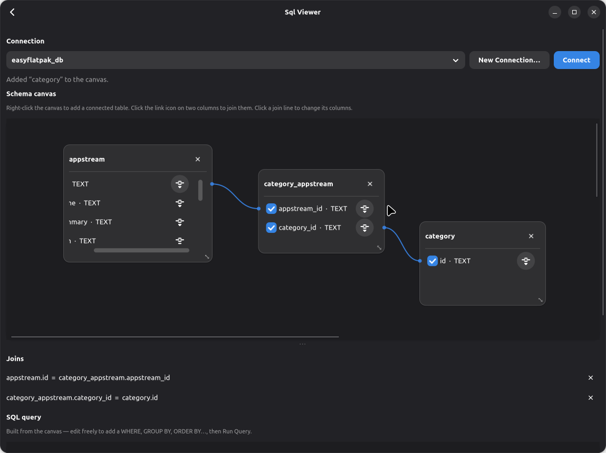

<div align="center">


# Dupot Dev Tools

**The developer's Swiss Army knife for the Linux desktop.**

Format, convert, encode, decode, hash… and explore your SQL databases visually.
All in one native, fast, offline GTK4 / Libadwaita application.




</div>

---

## ✨ Why Dupot Dev Tools?

How many times a day do you paste a JWT, a JSON blob or a SQL query into a random website just to read it?

Dupot Dev Tools gathers all those small everyday utilities in **one desktop app**:

- 🔒 **100% local** — your tokens, data and queries never leave your machine
- ⚡ **Native and lightweight** — Rust + GTK4, no Electron, no browser
- 🎨 **Fits your desktop** — Libadwaita UI, light and dark themes
- 🧩 **Modular** — each tool is a self-contained folder; adding one takes minutes

## 🧰 Tools

| Category | Tool | What it does |
|---|---|---|
| 🗄️ **Database** | **SQL Viewer** | Browse SQLite, PostgreSQL and MySQL databases on an interactive canvas |
| 🎨 **Formatting** | JSON | Prettify or minify JSON |
| | SQL | Format SQL queries |
| | XML | Format XML documents |
| 🔄 **Convert** | YAML ↔ JSON | Convert in both directions |
| | HTML → Text | Strip HTML tags to plain text |
| 🔐 **Encoding** | Base64 | Encode / decode Base64 |
| | URL | Percent-encode / decode |
| | HTML entities | Encode / decode HTML entities |
| | JWT | Decode JWT tokens to readable JSON |
| 🔤 **String** | Hash | MD5, SHA-1, SHA-2, SHA-3, BLAKE2b digests |

## 🗄️ Spotlight: SQL Viewer

A visual query builder that lets you understand a database at a glance:

- **Saved connections** to SQLite, PostgreSQL and MySQL
- **Drag tables onto a canvas** as resizable cards
- **Draw joins** by linking columns between tables
- **Pick the columns** you want and get the SQL query generated for you
- **Run it** and view the results instantly

| New connection | Add a table | Query result |
|---|---|---|
|  |  |  |

## 🚀 Getting started

### Debian / Ubuntu / Linux Mint

```bash
sudo apt install cargo pkg-config libgtk-4-dev libadwaita-1-dev libgtksourceview-5-dev
git clone https://github.com/imikado/dupotDevTools.git
cd dupotDevTools
cargo run --release
```

SQLite, PostgreSQL and MySQL drivers are built in — no extra packages needed.

### Nix

```bash
nix run            # build and launch
nix develop        # dev shell with cargo, clippy, rust-analyzer
cargo run
```

## 📦 Packaging

```bash
./build_flatpak.sh                  # -> org.dupot.devtools.flatpak (GNOME 50 runtime)
./build_windows.sh                  # in an MSYS2 UCRT64 shell -> export/windows/*.zip
```

## 🧩 Add your own tool

Each tool lives in its own folder under `src/infrastructure/ui/features/<category>/<tool>/`:

```
features/
└── string/
    └── hash/
        ├── mod.rs     # description + the tool's UI
        └── icon.png   # shown on the home page
```

`mod.rs`:

```rust
use gtk::prelude::*;

use crate::domain::contract::FeatureContract;

pub const DESCRIPTION: &str = "Generate cryptographic hash digests";

pub struct Feature;

impl FeatureContract for Feature {
    fn widget(&self) -> gtk::Widget {
        gtk::Label::new(Some("Hello from my new tool!")).upcast()
    }
}
```

Then declare the module in the category's `mod.rs` (`pub mod hash;`) and add one line to `registry()` in `features/mod.rs`:

```rust
feature!(string::hash),
```

A new category folder = a new sidebar section.

## 🤝 Contributing

Ideas, bug reports and pull requests are very welcome!
Got a small tool you use every day? Turn it into a feature and open a PR — that's exactly what this project is built for.

## 📄 License

[LGPL-2.1](LICENSE) — © Michael Bertocchi · [dupot.org](https://www.dupot.org)
