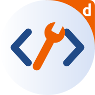
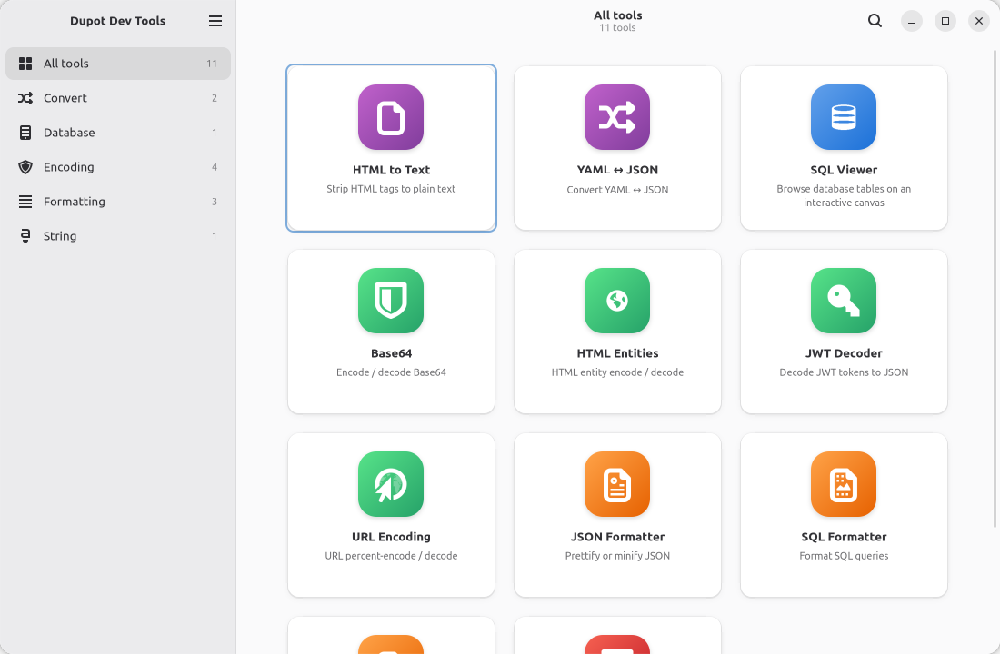
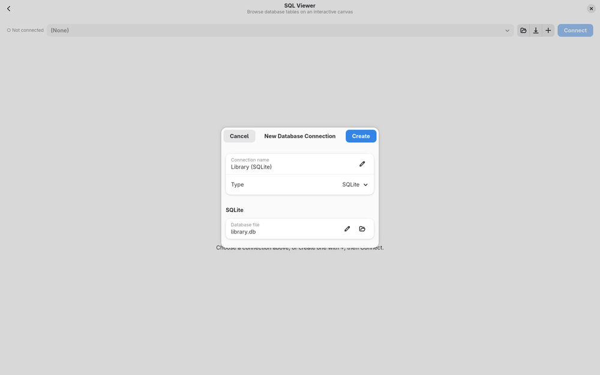
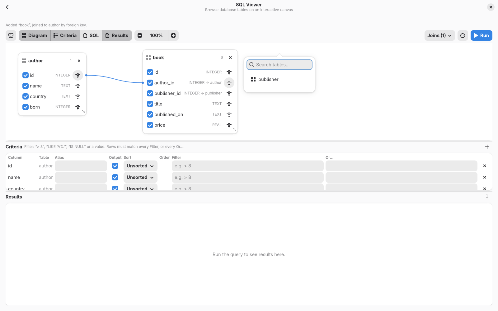
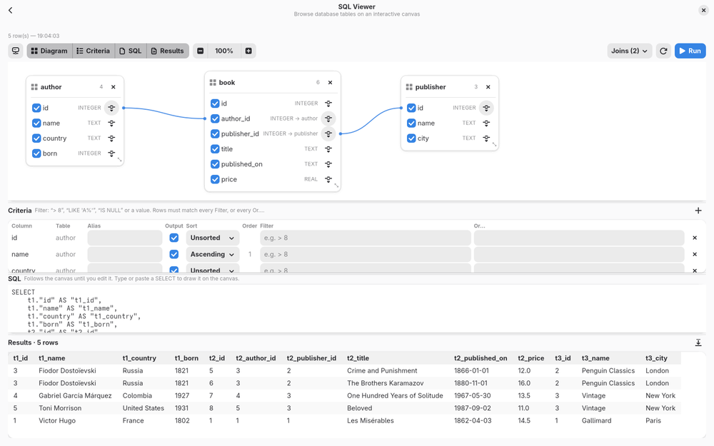

<div align="center">



# Dupot Dev Tools

**The developer's Swiss Army knife for the desktop.**

Format, convert, encode, decode, hash… and explore your SQL databases visually.
All in one native, fast, offline GTK4 / Libadwaita application written in Rust.




</div>

---

## ✨ Why Dupot Dev Tools?

How many times a day do you paste a JWT, a JSON blob or a SQL query into a random website just to read it?

Dupot Dev Tools gathers all those small everyday utilities in **one desktop app**:

- 🔒 **100% local**: your tokens, data and queries never leave your machine
- ⚡ **Native and lightweight**: a single Rust binary on GTK4, no Electron, no browser
- 🎨 **Fits your desktop**: Libadwaita UI, light and dark themes, adaptive layout, search across tools
- 🧩 **Easy to extend**: clean architecture, each tool is a small tested module

## 🧰 Tools

| Category | Tool | What it does |
|---|---|---|
| 🗄️ **Database** | **SQL Viewer** | Browse SQLite, PostgreSQL and MySQL databases on an interactive canvas |
| 🎨 **Formatting** | JSON Formatter | Prettify or minify JSON |
| | SQL Formatter | Format SQL queries |
| | XML Formatter | Format XML documents |
| 🔄 **Convert** | YAML ↔ JSON | Convert in both directions |
| | HTML to Text | Strip HTML tags to plain text |
| 🔐 **Encoding** | Base64 | Encode / decode Base64 |
| | URL Encoding | Percent-encode / decode |
| | HTML Entities | Encode / decode HTML entities |
| | JWT Decoder | Decode JWT tokens to readable JSON |
| 🔤 **String** | Hash Generator | MD5, SHA-1, SHA-2, SHA-3, BLAKE2b digests |

Every text tool shares the same layout: syntax-highlighted input and output side by side (stacked on narrow windows), one-click copy, and errors shown inline.

## 🗄️ Spotlight: SQL Viewer

A visual query builder that lets you understand a database at a glance:

- **Connect** to SQLite, PostgreSQL and MySQL (drivers built in, nothing else to install)
- **Drop tables onto a canvas** as movable, resizable cards
- **Draw joins** by linking columns between tables; click a line to edit or remove it
- **Pick the columns** you want and get the SQL query generated for you, then edit it freely
- **Run it**, browse the results and **export them to CSV**

| New connection | Add a table | Query result |
|---|---|---|
|  |  |  |

## 🛠️ Tech stack

| Layer | Technology |
|---|---|
| Language | Rust (2024 edition) |
| UI | GTK 4 + Libadwaita via [gtk-rs](https://gtk-rs.org), GtkSourceView 5 for code editors |
| Databases | `rusqlite` (bundled SQLite), `postgres`, `mysql` (pure-Rust, no client libraries needed) |
| Formats | `serde_json`, `serde_yaml_ng`, `quick-xml`, `sqlformat`, `html2text`, `csv` |
| Encoding / crypto | `base64`, `percent-encoding`, `html-escape`, RustCrypto (`md-5`, `sha1`, `sha2`, `sha3`, `blake2`) |
| Build & packaging | Cargo, Nix flake, Flatpak (GNOME 50 runtime), MSYS2 for Windows |

## 🚀 Getting started

### Debian / Ubuntu / Linux Mint

```bash
sudo apt install cargo pkg-config libgtk-4-dev libadwaita-1-dev libgtksourceview-5-dev
git clone https://github.com/imikado/dupotDevTools.git
cd dupotDevTools
cargo run --release
```

Requires GTK ≥ 4.14 and Libadwaita ≥ 1.5 (Debian 13, Ubuntu 24.04 or newer).

### Fedora

```bash
sudo dnf install cargo gtk4-devel libadwaita-devel gtksourceview5-devel
cargo run --release
```

### Nix

```bash
nix run github:imikado/dupotDevTools   # build and launch
```

### Windows

Build from an [MSYS2](https://www.msys2.org) UCRT64 shell with `./build_windows.sh` (see [Packaging](#-packaging)).

## 👩‍💻 Development

```bash
nix develop        # cargo, clippy, rustfmt, rust-analyzer + GTK libraries
cargo run          # launch in debug mode
cargo test         # unit tests
cargo clippy --all-targets
```

**VSCode**: open the folder, no need to start it from `nix develop`:

- **F5** debugs, **Ctrl+F5** runs (requires the [CodeLLDB](https://marketplace.visualstudio.com/items?itemName=vadimcn.vscode-lldb) extension)
- tasks for `cargo build`, `run`, `test`, `clippy` (Ctrl+Shift+P → *Run Task*)
- rust-analyzer is started inside the Nix dev shell automatically

All of these go through [`.vscode/nix-cargo.sh`](.vscode/nix-cargo.sh) and [`.vscode/rust-analyzer.sh`](.vscode/rust-analyzer.sh).

## 📦 Packaging

| Target | Command | Output |
|---|---|---|
| Nix | `nix build` | `result/bin/dupot-dev-tools` (runs the tests too) |
| Flatpak | `./build_flatpak.sh` | `org.dupot.devtools.flatpak` (GNOME 50 runtime) |
| Windows | `./build_windows.sh` in MSYS2 UCRT64 | `export/windows/DupotDevTools-<version>-windows-x64.zip` |

Flatpak metadata (manifest, desktop file, AppStream, icons) lives in [`export/flatpak/`](export/flatpak/); the icons are generated from [`src/assets/logo.svg`](src/assets/logo.svg).

## 🏗️ Architecture

Clean architecture in two layers, with unit tests mirroring the sources:

```
src/
├── lib.rs / main.rs
├── domain/                              # pure Rust: no GTK, no I/O
│   ├── error.rs                         # DomainError (any library error converts with `?`)
│   ├── entity/                          # FeatureEntity, database types, connection form
│   ├── contract/                        # DatabaseRepository (implemented by infrastructure)
│   ├── shared/                          # helpers shared by tools (pretty JSON…)
│   └── feature/<category>/<tool>.rs     # each tool's ENTITY (metadata) + logic
└── infrastructure/
    ├── api/                             # SQLite / PostgreSQL / MySQL DatabaseRepository
    ├── service/                         # tool catalog (sorting, sections)
    └── ui/                              # GTK / Libadwaita
        ├── app_window.rs                # sidebar, search, tool cards
        ├── feature_contract.rs          # trait every tool view implements
        ├── shared/                      # InputOutputWidget, CodeView
        └── features/<category>/<tool>/  # mod.rs (view) + icon.png

tests/                                   # same tree as src/
├── unit.rs                              # single entry point
├── domain/feature/encoding/base64_encoding.rs   # tests src/domain/feature/encoding/base64_encoding.rs
└── …
```

**Rules**

- `domain` never depends on `infrastructure`, GTK or the file system; it only gets data in and returns results or `DomainError`.
- Views are thin: they read widgets, call the domain, and display the result.
- Infrastructure dependencies are reached through domain contracts (`DatabaseRepository`), so they can be replaced in tests.
- The tests for `src/X.rs` live in `tests/X.rs`.

## 🧩 Add your own tool

A tool = one domain module (logic), one view, one test file, all at the same path.

**1. Logic**: `src/domain/feature/string/reverse.rs` (+ `pub mod reverse;` in `string/mod.rs`):

```rust
use crate::domain::entity::feature_entity::FeatureEntity;

pub const ENTITY: FeatureEntity = FeatureEntity {
    name: "reverse",
    section: "string",
    title: "Reverse Text",
    description: "Reverse a string",
};

pub fn reverse(input: &str) -> String {
    input.chars().rev().collect()
}
```

**2. View**: `src/infrastructure/ui/features/string/reverse/mod.rs` + `icon.png` (+ `pub mod reverse;` in `string/mod.rs`):

```rust
use crate::domain::feature::string::reverse;
use crate::infrastructure::ui::feature_contract::FeatureContract;
use crate::infrastructure::ui::shared::input_output_widget::{InputOutputWidget, Options};

pub struct Feature;

impl FeatureContract for Feature {
    fn widget(&self) -> gtk::Widget {
        let tool = InputOutputWidget::new(Options::default());
        tool.add_button("Reverse", |t| t.report(Ok(reverse::reverse(&t.input()))));
        tool.into_widget()
    }
}
```

Then one line in `registry()` (`src/infrastructure/ui/features/mod.rs`):

```rust
feature!(string::reverse),
```

**3. Tests**: `tests/domain/feature/string/reverse.rs` (+ `mod reverse;` in `tests/domain/feature/string/mod.rs`):

```rust
use dupot_dev_tools::domain::feature::string::reverse::reverse;

#[test]
fn reverses_unicode() {
    assert_eq!(reverse("héllo"), "olléh");
}
```

A new category folder = a new sidebar section. The registry tests check that every tool has a unique name, metadata and a PNG icon in the matching folder.

## 🤝 Contributing

Ideas, bug reports and pull requests are very welcome!
Got a small tool you use every day? Turn it into a feature and open a PR: that's exactly what this project is built for.

Before opening a PR: `cargo fmt`, `cargo clippy --all-targets` and `cargo test` should all pass.

## 📄 License

[LGPL-2.1](LICENSE) © Michael Bertocchi · [dupot.org](https://www.dupot.org)
